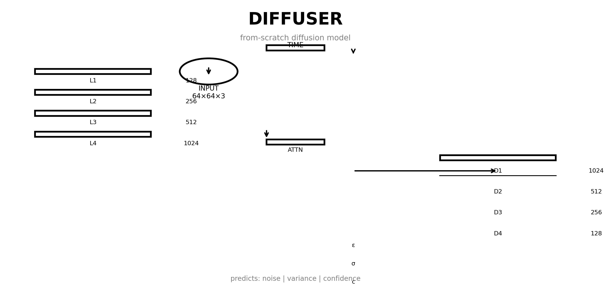

<div align="center">

# 🌫️ diffuser

**a from-scratch diffusion model that learns to denoise images by predicting not just noise, but also its uncertainty and confidence**

[]()
[]()
[]()
[]()

</div>

---



## quickstart

```bash
pip install -r requirements.txt
python src/train.py --config configs/base.yaml
```

## structure

```
diffuser/
├── src/*.py           # model, schedule, loss, data, sampler, trainer
├── configs/base.yaml  # model + training config
├── scripts/           # sample, explore, viz
├── tests/             # test suite
├── Dockerfile
└── README.md
```

## license

MIT